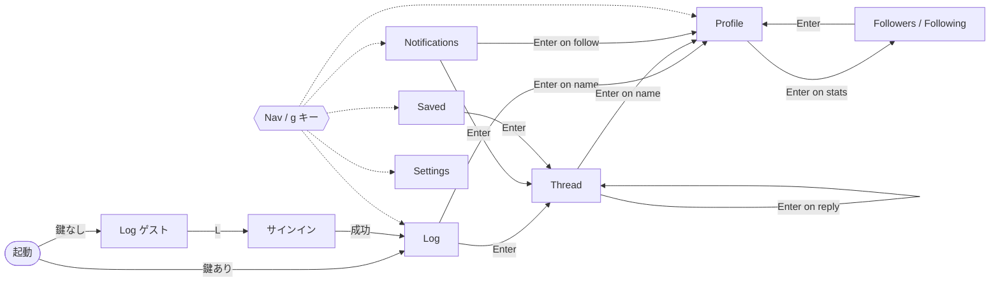

# lazydn 画面設計

lazydn は [dev-null.sh](https://dev-null.sh) の TUI クライアントです。このドキュメントでは、lazydn の画面構成、各画面の要素、画面遷移、キーバインドを定めます。

> **方針**: Web 版の画面構成に、できるだけ近づけます。Web 版を使い慣れたユーザーが、迷わずに使えることを優先するためです。Web 版の構成は、ソースコード [nunomaduro/dev-null.sh](https://github.com/nunomaduro/dev-null.sh)（branch `production`、2026-10-20 時点）の `resources/js/` を読んで確かめました。API の仕様は [dev-null-api.md](./dev-null-api.md) を参照してください。

## 概要

| 項目 | 内容 |
| --- | --- |
| 踏襲するもの | 3 カラム構成、ナビの項目、commit カードの見た目（lane レール、hash、アクション行）、タブ、git 風の文言、Web 版のキーボードショートカット |
| 置き換えるもの | アバターと画像はテキストで表します。ホバーは選択中の項目で、フォントの違いは太字・dim・色で代替します |
| 対象外 | API がない機能（[Web 版との差分](#web-版との差分) を参照） |
| 前提 | サインインすると、署名付き API で全機能を使えます。サインインしなければゲストとして、公開 API の範囲だけで動きます |

### なぜ画像を表示しないのか

kitty や sixel のグラフィックプロトコルを使えば、アバターや添付画像も端末に表示できます。それでも採用しない理由は次の 3 つです。

- 対応している端末が限られ、tmux を挟むと表示が崩れやすい
- 画像を取得してデコードするコストが、タイムラインのスクロールに響く
- 画像の有無で行の高さが変わり、レイアウトを計算しにくくなる

そこで、アバターは lane 色のノード（`◉`）に、画像は `[image 1/2 1200x800]` という表記に置き換えます。将来、画像を表示したくなったときは、`[image …]` を表示している位置に画像ウィジェットを差し込めば済みます。

## 全体レイアウト

### 端末幅による切り替え

Web 版は、画面幅に応じて 3 カラム（xl）、2 カラム（lg）、1 カラム（mobile）を切り替えます。lazydn も、端末の列数で同じように切り替えます。

| 端末幅 | 構成 | Web 版で対応するもの |
| --- | --- | --- |
| 120 列以上 | Nav（20 列）＋ Main（可変）＋ Aside（32 列） | xl（1280px 以上） |
| 80〜119 列 | Nav（アイコンだけの 4 列）＋ Main（可変） | lg / md（Aside なし、Nav は折りたたみ） |
| 80 列未満 | 上部のナビバー ＋ Main | mobile（MobileHeader ＋ 下部のタブバー） |

- Main の中身は、どの幅でも同じ部品で描きます。変わるのは、外側の枠と、commit カードの中で折り返す位置だけです。
- 高さが 20 行に満たないときは、画面の代わりに `terminal too small (need 20 rows)` とだけ表示します。

**120 列（3 カラム）**: ここでは Log 画面を例にしています。

```text
┌ /dev/null ───────┐┏ Log ━━━━━━━━━━━━━━━━━━━━━━━━━━━━━━━━━━━━━━━━━━━━━━━━━━━━━━━━━━━━━┓┌ Me ──────────────────────────┐
│ a social network │┃      Following               Latest               Trending       ┃│ ◉ myuron                     │
│ for devs         │┃      ━━━━━━━━━                                                   ┃│ ● @myuron                    │
│                  │┃ ┆                                                                ┃│                              │
│▌◉ Log            │┃ ◌  What did you ship?                                            ┃│ 42 commits                   │
│  ◎ Notifications │┃ ┆                                    [c] Write a commit          ┃│ 10 following  12 followers   │
│                12│┃ ┆                                                                ┃│ ◓ 7/10 pasteis left          │
│  ◯ Profile       │┃                         ↑ 3 new commits                          ┃│                              │
│  ⊡ Saved         │┃ ╎ ── Today ───────────────────────────────────────────────────── ┃│ Rust / TUI enjoyer           │
│  ⚙ Settings      │┃ │                                                                ┃│                              │
│                  │┃▌◉ Alice @alice · 3m  [1/2]                               a1b2c3d ┃│                              │
│ [ c  Commit ]    │┃▌│ shipped a terminal client for /dev/null with `ratatui`         ┃└──────────────────────────────┘
│                  │┃▌│ ┌ rust ─────────────────────────────────┐                      ┃┌ Keys ────────────────────────┐
│                  │┃▌│ │ fn main() { println!("hello"); }      │                      ┃│ j/k  move     ↵  open        │
│                  │┃▌│ └───────────────────────────────────────┘                      ┃│ c    commit   r  reply       │
│                  │┃▌│ ☆ 12  ◓ 3  ❝ Quote  ↩ Reply  ⌄ 2 replies                   ⊡ ⚑ ┃│ s    star     o  replies     │
│                  │┃▌│ ├─● Bob @bob · 1m                                              ┃│ ?    all keys                │
│                  │┃▌│ │     nice! which crate for ssh sigs?                          ┃│                              │
│                  │┃▌│ └─● Carol @carol · now                                         ┃│                              │
│                  │┃▌│       ↳ replying to @bob                                       ┃└──────────────────────────────┘
│                  │┃▌│       ssh-key has SshSig                                       ┃                                
│                  │┃ │                                                                ┃                                
│                  │┃ ◉ Dave @dave · 25m                                       9f8e7d6 ┃                                
│                  │┃ │ ┌ ❝ Erin @erin · 2h ──────────────────────┐                    ┃                                
│                  │┃ │ │ git push --force on a friday            │                    ┃                                
│                  │┃ │ └─────────────────────────────────────────┘                    ┃                                
│                  │┃ │ never.                                                         ┃                                
│                  │┃ │ ★ 40  ◓ 0  ❝ Quote  ↩ Reply                                ⊡ ⚑ ┃                                
│                  │┃ ╌╌ HEAD@{last visit} ╌╌╌╌╌╌╌╌╌╌╌╌╌╌╌╌╌╌╌╌╌╌╌╌╌╌╌╌╌╌╌╌╌╌╌╌╌╌╌╌╌╌╌ ┃                                
│                  │┃ │                                                                ┃                                
│                  │┃ ◉ Frank @frank · 1h                                      0c1d2e3 ┃                                
│                  │┃ │ [image 1/2 1200x800] [image 2/2 800x800]                       ┃                                
│                  │┃ │ ┌ example.com ─────────────────────────────┐                   ┃                                
│                  │┃ │ │ Ratatui 1.0 released                     │                   ┃                                
│                  │┃ │ └──────────────────────────────────────────┘                   ┃                                
│ @myuron          │┃ │ ☆ 5  ◓ 1  ❝ Quote  ↩ Reply                                 ⊡ ⚑ ┃                                
│                  │┃ ┊ (loading more...)                                              ┃                                
└──────────────────┘┗━━━━━━━━━━━━━━━━━━━━━━━━━━━━━━━━━━━━━━━━━━━━━━━━━━━━━━━━━━━━━━━━━━┛                                
 Log > Following  j/k move  ↵ open  c commit  Tab pane  ? help                                    API 118/120  ● online 
```

**80 列（2 カラム）**

```text
┌──┐┏ Log ━━━━━━━━━━━━━━━━━━━━━━━━━━━━━━━━━━━━━━━━━━━━━━━━━━━━━━━━━━━━━━━━━━━━━┓
│  │┃       Following                 Latest                 Trending          ┃
│▌◉│┃       ━━━━━━━━━                                                          ┃
│ ◎│┃ ┆                                                                        ┃
│ ◯│┃ ◌  What did you ship?                                                    ┃
│ ⊡│┃ ┆                                    [c] Write a commit                  ┃
│ ⚙│┃ ┆                                                                        ┃
│  │┃                             ↑ 3 new commits                              ┃
│ +│┃ ╎ ── Today ───────────────────────────────────────────────────────────── ┃
│  │┃ │                                                                        ┃
│  │┃▌◉ Alice @alice · 3m  [1/2]                                       a1b2c3d ┃
│  │┃▌│ shipped a terminal client for /dev/null with `ratatui`                 ┃
│  │┃▌│ ┌ rust ─────────────────────────────────┐                              ┃
│  │┃▌│ │ fn main() { println!("hello"); }      │                              ┃
│  │┃▌│ └───────────────────────────────────────┘                              ┃
│  │┃▌│ ☆ 12  ◓ 3  ❝ Quote  ↩ Reply  ⌄ 2 replies                           ⊡ ⚑ ┃
│  │┃▌│ ├─● Bob @bob · 1m                                                      ┃
│  │┃▌│ │     nice! which crate for ssh sigs?                                  ┃
│  │┃▌│ └─● Carol @carol · now                                                 ┃
│  │┃▌│       ↳ replying to @bob                                               ┃
│  │┃▌│       ssh-key has SshSig                                               ┃
│  │┃ │                                                                        ┃
│  │┃ ◉ Dave @dave · 25m                                               9f8e7d6 ┃
│  │┃ │ ┌ ❝ Erin @erin · 2h ──────────────────────┐                            ┃
│  │┃ │ │ git push --force on a friday            │                            ┃
│  │┃ │ └─────────────────────────────────────────┘                            ┃
│  │┃ │ never.                                                                 ┃
│  │┃ │ ★ 40  ◓ 0  ❝ Quote  ↩ Reply                                        ⊡ ⚑ ┃
│  │┃ ╌╌ HEAD@{last visit} ╌╌╌╌╌╌╌╌╌╌╌╌╌╌╌╌╌╌╌╌╌╌╌╌╌╌╌╌╌╌╌╌╌╌╌╌╌╌╌╌╌╌╌╌╌╌╌╌╌╌╌ ┃
│  │┃ │                                                                        ┃
│  │┃ ◉ Frank @frank · 1h                                              0c1d2e3 ┃
│  │┃ │ [image 1/2 1200x800] [image 2/2 800x800]                               ┃
│  │┃ │ ┌ example.com ─────────────────────────────┐                           ┃
│  │┃ │ │ Ratatui 1.0 released                     │                           ┃
│  │┃ │ └──────────────────────────────────────────┘                           ┃
│  │┃ │ ☆ 5  ◓ 1  ❝ Quote  ↩ Reply                                         ⊡ ⚑ ┃
│  │┃ ┊ (loading more...)                                                      ┃
└──┘┗━━━━━━━━━━━━━━━━━━━━━━━━━━━━━━━━━━━━━━━━━━━━━━━━━━━━━━━━━━━━━━━━━━━━━━━━━━┛
 Log > Following  j/k move  ↵ open  c commit  ? help                    118/120 
```

**60 列（1 カラム）**

```text
┌ /dev/null ───────────────────────────────────────────────┐
│ Log  Notifs(12)  Profile  Saved  Settings                │
└──────────────────────────────────────────────────────────┘
┏ Log ━━━━━━━━━━━━━━━━━━━━━━━━━━━━━━━━━━━━━━━━━━━━━━━━━━━━━┓
┃     Following            Latest            Trending      ┃
┃     ━━━━━━━━━                                            ┃
┃ ┆                                                        ┃
┃ ◌  What did you ship?                                    ┃
┃ ┆                                    [c] Write a commit  ┃
┃ ┆                                                        ┃
┃                     ↑ 3 new commits                      ┃
┃ ╎ ── Today ───────────────────────────────────────────── ┃
┃ │                                                        ┃
┃▌◉ Alice @alice · 3m  [1/2]                       a1b2c3d ┃
┃▌│ shipped a terminal client for /dev/null with `ratatui` ┃
┃▌│ ┌ rust ─────────────────────────────────┐              ┃
┃▌│ │ fn main() { println!("hello"); }      │              ┃
┃▌│ └───────────────────────────────────────┘              ┃
┃▌│ ☆ 12  ◓ 3  ❝ Quote  ↩ Reply  ⌄ 2 replies           ⊡ ⚑ ┃
┃▌│ ├─● Bob @bob · 1m                                      ┃
┃▌│ │     nice! which crate for ssh sigs?                  ┃
┃▌│ └─● Carol @carol · now                                 ┃
┃▌│       ↳ replying to @bob                               ┃
┃▌│       ssh-key has SshSig                               ┃
┃ │                                                        ┃
┃ ◉ Dave @dave · 25m                               9f8e7d6 ┃
┗━━━━━━━━━━━━━━━━━━━━━━━━━━━━━━━━━━━━━━━━━━━━━━━━━━━━━━━━━━┛
 j/k ↵ c ?                                          118/120 
```

### 共通部品

| 部品 | 内容 |
| --- | --- |
| Nav | 上から順に、ロゴ（`/dev/null`、a social network for devs）、Log、Notifications（未読数。99 を超えたら `99+`）、Profile、Saved、Settings、`[ c  Commit ]` ボタン、最下部に `@自分` を並べます。現在の画面には `▌` を付けて、primary 色で表示します |
| Main | 現在の画面です。枠のタイトルに画面名（`Log`、`← Commit` など）を表示します |
| Aside | 自分のサマリー（名前、@handle と lane 色、commit 数、フォロー数とフォロワー数、bio、残りの pastel 数）と、よく使うキーのヒントを表示します。Web 版の Who to follow と Search は API がないので載せません |
| ステータスライン | 左にパンくず（`Log > Following`）と、その画面のキーのヒントを、右に API の残り回数（`X-RateLimit-Remaining`）と接続状態を表示します |
| トースト | ステータスラインの上に重ねて出し、3 秒で消えます（[モーダルとオーバーレイ](#モーダルとオーバーレイ) を参照） |

- **フォーカス**: フォーカスのあるペインは太線の枠（`┏━┓`）で、ないペインは細線の枠（`┌─┐`）で描きます。モーダルは二重線（`╔═╗`）です。
- **選択中の項目**: 左端に `▌` を付け、背景をわずかに明るくします。Web 版にはホバー時のハイライトや lane dimming がありますが、マウスを前提にしているので、選択中の項目で代わりに表現します。
- **Tab** で Nav → Main → Aside の順にフォーカスを移します。Aside は表示しているだけなので、通常は Nav と Main を行き来するだけです。

## commit カード

commit カードは、Log、Thread、Profile、Saved のどの画面でも使う部品です。Web 版の `commit-card.tsx` と `graph-rail.tsx` の構成を、そのまま写しています。

```text
 │                                                        ← 前のカードから続く lane レール
 ◉ Alice @alice · 3m  [1/2] [in review]          a1b2c3d  ← ヘッダー
 │ ↳ replying to @bob                                     ← 返信のときだけ
 │ 本文 `inline code`                                      ← 本文
 │ ┌ rust ──────────────────────┐                         ← コードブロック
 │ │ fn main() {}               │
 │ └────────────────────────────┘
 │ Show more                                              ← 折りたたんだとき
 │ [image 1/2 1200x800] [poll] [quote box] [link card]    ← 付属物
 │ ☆ 12  ◓ 3  ❝ Quote  ↩ Reply  ⌄ 2 replies          ⊡ ⚑  ← アクション行
 │ ├─● Bob @bob · 1m                                      ← 返信プレビュー
 │ │     ...
 ●                                                        ← lane の終わり
```

### lane レールとノード

| 要素 | 表示 | 内容 |
| --- | --- | --- |
| レール | `│`（作者の lane 色） | Web 版の 2px の縦線に当たります |
| ノード | `◉`（lane 色） | Web 版の、lane 色の輪で囲んだアバターに当たります |
| 同じ作者が続くとき | `•` | Web 版でもノードが小さな点になります |
| 削除済み | `◌`（dim） | tombstone です |
| 未投稿（composer） | `┆` と `◌` | Web 版の、点線の「staged」レーンです |
| 日付の区切り | `╎ ── Today ───` | Today / Yesterday / `Mon, Oct 20` |
| 前回の続き | `╌╌ HEAD@{last visit} ╌╌` | 前回の起動時に最後に見た commit の位置です |
| 一覧の終わり | `○ That's the root commit. There's nothing before it.` | 次の cursor がないときに表示します |

### lane 色

Web 版のダークテーマの値に合わせます。ユーザーごとの lane は API の `lane`（0〜5 の整数、またはカスタムの hex 文字列）から決めます。

| lane | 名前 | 色 |
| --- | --- | --- |
| 0 | orange | `#ff8a4c` |
| 1 | green | `#51cf66` |
| 2 | violet | `#da77f2` |
| 3 | teal | `#3bc9db` |
| 4 | rose | `#f06595` |
| 5 | ochre | `#fcc419` |
| 文字列 | custom | その hex をそのまま使います |

- truecolor に対応していない端末（`COLORTERM` が `truecolor` でも `24bit` でもない端末）では、最も近い 256 色に変換します。
- ゲストとして公開 API を呼ぶと、`lane` が返りません。そのときは username のハッシュ値から 0〜5 を選びます。Web 版の Automatic と同じ値にはなりませんが、同じユーザーにはいつも同じ色が付きます。

### ヘッダー

- 太字の `Name`、mono 表示の `@handle`、`·`、相対時刻（`now`、`5m`、`3h`、`2d`。7 日を超えたら `Oct 20`）の順に並べ、右端に `short_hash` を置きます。
- 自分の commit で `status` が `pending` または `rejected` のときは、`[in review]` / `[rejected]` のバッジを付けます。
- スレッドの中での位置は `[2/5]` で表します。

### 本文

- 署名付きの応答に含まれる、本文の分割結果（地の文・インラインコード・コードブロック）を使って描きます。ゲストのときは `body` をそのまま表示します。
- インラインコードは背景色を変えて表示します。コードブロックは、言語ラベル付きの枠で囲み、色付けします。
- 本文が 280 文字か 8 行を超えたら折りたたみ、`Show more` と表示します。Web 版と同じ基準です。Thread 画面の本体の commit は折りたたみません。

### 付属物

| 付属物 | 表示 |
| --- | --- |
| 画像 | `[image 1/2 1200x800]`。`description` があれば、続けて表示します |
| link card | 枠の中に、mono 表示のサイト名、タイトル（2 行まで）、説明（2 行まで）を並べます |
| 引用 commit | 枠の中に、`❝ Name @handle · 2h` と本文の抜粋を表示します。見られないときは、点線の枠に `[deleted] This commit was deleted.` / `[unavailable] This commit isn't available.` と表示します |
| poll | 選択肢ごとに `▇▇▇▇░░ 62% label` のバーを描き、締め切りまでの時間か `Final results` を添えます。投票は API にないので、表示だけです |

### アクション行

| アイコン | ASCII モード | 内容 | キー |
| --- | --- | --- | --- |
| `☆ 12` / `★ 12` | `* 12` | star（付けたら `★` と primary 色） | `s` |
| `◓ 3` | `p 3` | pastel。pastéis モードがオフなら表示しません | `p` |
| `❝ Quote` | `" Quote` | 引用 | `q` |
| `↩ Reply` | `< Reply` | 返信。下書きがあれば `stash@{0}` と表示します | `r` |
| `⌄ 2 replies` | `v 2 replies` | 返信プレビューの開閉 | `o` |
| `⊡` / `⊠` | `[ ]` / `[x]` | 保存 | `b` |
| `⚑` | `!` | 通報 | `!` |

- Web 版の pastel のアイコンは 🥧 ですが、ここでは `◓` を使います。絵文字は端末によって表示幅が 1 列にも 2 列にもなり、罫線がずれる原因になるからです。
- 罫線と記号を表示できない端末のために、設定（Appearance）で ASCII モードに切り替えられるようにします。

### 返信プレビュー

- 一覧の API が返す `reply_preview` を、カードの下に罫線（`├─` `└─`）でネストして表示します。表示する件数は設定（Appearance）で決めます。既定値は 3 件で、Web 版と同じです。
- ネストは 3 段までにします。それより深い返信は平らに並べ、`↳ replying to @x` を付けます。
- 続きがあるときは、`Show N more` を表示します。

## 画面ごとの設計

各画面のモックアップは、Main ペイン（68 列）の部分だけを描いています。Nav と Aside は [全体レイアウト](#全体レイアウト) と同じです。

### Log（タイムライン）

起動直後に開く画面です。Web 版の `/log/{log}` に当たります。モックアップは [全体レイアウト](#全体レイアウト) の 3 つの図を参照してください。

| 要素 | 内容 |
| --- | --- |
| タブ | `Following │ Latest │ Trending`。`1`〜`3` で切り替えます。選んだタブには、下に `━` の線を引きます |
| インライン composer | タブのすぐ下に置きます。`c` を押すと、フォーカスがここへ移ります。ゲストには表示しません |
| 新着の通知 | 30 秒ごとに `since=<先頭の commit の id>` を付けて取得し、`new_commits_count` が 1 以上なら `↑ N new commits` を表示します。`R` を押すか、一覧の先頭で `k` を押すと読み込みます |
| 一覧 | commit カードを並べます。最後から 5 件以内まで進んだら、`cursor` で次の 20 件を先に読み込みます |

- **Trending のとき**: `is_ranked` が `true` で、並びが新しい順ではありません。そのため、新着の通知と日付の区切りは表示しません。
- **Following が空のとき**: `suggestions` があれば、`$ who --should-i-follow` という見出しの下に、おすすめの commit を並べます。`suggestions` も空なら、`fatal: your log does not have any commits yet` と表示します。
- **ゲストのとき**: Following は使えないので、Latest を開きます。Following タブを選ぶと、サインインのダイアログを出します。
- **取得に失敗したとき**: いま表示している一覧はそのまま残し、トーストでエラーを伝えます。最初の読み込みで失敗したときだけ、一覧の位置に `error: <code> — press R to retry` と表示します。

使う API: `GET /v1/log/{log}`

### Thread（commit の詳細）

一覧で `Enter` を押すと開きます。Web 版の `/@{user}/commits/{id}` に当たります。

```text
┏ ← Commit ━━━━━━━━━━━━━━━━━━━━━━━━━━━━━━━━━━━━━━━━━━━━━━━━━━━━━━━━┓
┃                                             a1b2c3d  y copy link ┃
┃ │                                                                ┃
┃ ◉ Zoe @zoe · 2h                                          5a6b7c8 ┃
┃ │ what is everyone building this weekend?                        ┃
┃ │ ☆ 8  ◓ 0  ❝ Quote  ↩ Reply                                 ⊡ ⚑ ┃
┃ │                                                                ┃
┃ ◌ [deleted] This commit was deleted.                             ┃
┃ │                                                                ┃
┃ ◉ Alice @alice  [1/2]                                            ┃
┃ │ shipped a terminal client for /dev/null with `ratatui`.        ┃
┃ │ it mirrors the web layout: lanes, cards, tabs, all of it.      ┃
┃ │ ┌ rust ─────────────────────────────────┐                      ┃
┃ │ │ fn main() { println!("hello"); }      │                      ┃
┃ │ └───────────────────────────────────────┘                      ┃
┃ │ Oct 20, 2026 14:02 · commit a1b2c3d                            ┃
┃ │ ★ 13  ◓ 3  ❝ Quote  ↩ Reply                                ⊡ ⚑ ┃
┃ │                                                                ┃
┃ • Alice  [2/2]                                                   ┃
┃ │ source: github.com/myuron/lazydn                               ┃
┃ │                                                                ┃
┃ ├─● Bob @bob · 1m                                                ┃
┃ │ │   nice! which crate for ssh sigs?                            ┃
┃ │ │   ☆ 1  ↩ Reply                                               ┃
┃ │ │ └─● Carol @carol · now                                       ┃
┃ │ │       ssh-key has SshSig                                     ┃
┃ │ └─ ◌ [deleted] This commit was deleted.                        ┃
┃ │      └─● Dan @dan · now                                        ┃
┃ │            ...                                                 ┃
┃ ┊ Show 12 more                                                   ┃
┗━━━━━━━━━━━━━━━━━━━━━━━━━━━━━━━━━━━━━━━━━━━━━━━━━━━━━━━━━━━━━━━━━━┛
```

| 要素 | 内容 |
| --- | --- |
| ヘッダー | `← Commit` と、右端に short_hash を表示します。`Esc` で前の画面に戻ります |
| ancestors | 返信元の commit を、古い順に並べます。削除済みのものは tombstone で表示します |
| 本体の commit | 本文を折りたたみません。右上の hash は出さず、代わりに `Oct 20, 2026 14:02 · commit a1b2c3d` の行を付けます |
| 同じ作者による続き | 作者が自分の commit に続けて返信したものを、`•` のノードと `[2/2]` で表示します |
| 返信 | 古い順に並べ、3 段までネストします。末尾まで進むと、`cursor` で続きを読み込みます |

- 開いたときは、本体の commit を選んだ状態にします。`k` で ancestors へ、`j` で返信へ移ります。
- 返信が付いた commit を削除すると、tombstone（`◌ [deleted] This commit was deleted.`）として残ります。その下の返信は、そのまま表示します。
- 見られない commit（`404 commit_unavailable`）を開いたときは、`fatal: commit a1b2c3d is not available` と表示します。

使う API: `GET /v1/commits/{id}`（`ancestors` を含む）、`GET /v1/commits/{id}/replies`

### Profile

Nav の Profile（`g p`）か、カードの作者名で `Enter` を押すと開きます。Web 版の `/@{user}` に当たります。

```text
┏ Alice · 187 commits ━━━━━━━━━━━━━━━━━━━━━━━━━━━━━━━━━━━━━━━━━━━━━┓
┃                                                                  ┃
┃ ◉ Alice                          [f] Follow  [m] Mute  [B] Block ┃
┃ ● @alice  [Follows you]                                          ┃
┃                                                                  ┃
┃ Building terminal things. Rust, Nix, coffee.                     ┃
┃ ⌂ @laravel   ⚲ Portugal   ⛓ alice.dev   Joined Oct 2026          ┃
┃                                                                  ┃
┃ 187 commits   87 following   3647 followers   ◓ 42 received      ┃
┃                                                                  ┃
┃             Commits                          Replies             ┃
┃             ━━━━━━━                                              ┃
┃ │                                                                ┃
┃ ⚲ Pinned                                                         ┃
┃ ◉ Alice @alice · Oct 15                                  1a2b3c4 ┃
┃ │ hello /dev/null                                                ┃
┃ │ ☆ 210  ◓ 30  ❝ Quote  ↩ Reply                              ⊡ ⚑ ┃
┃ │                                                                ┃
┃ ◉ Alice @alice · 3m                                      a1b2c3d ┃
┃ │ shipped a terminal client for /dev/null ...                    ┃
┃ ┊                                                                ┃
┗━━━━━━━━━━━━━━━━━━━━━━━━━━━━━━━━━━━━━━━━━━━━━━━━━━━━━━━━━━━━━━━━━━┛
```

| 要素 | 内容 |
| --- | --- |
| ヘッダー | 名前、lane 色の `●`、`@handle`、`[Follows you]` / `[Muted]` のバッジを表示します |
| 操作 | 他人のプロフィールでは、`f` でフォロー、`m` でミュート、`B` でブロックします。自分のプロフィールには、`O` で GitHub を開く操作だけを出します |
| bio と meta | company、location、website、`Joined Month Year` を表示します |
| 統計 | commits、following、followers、受け取った pastel の数を表示します。following と followers で `Enter` を押すと、[Followers / Following](#followers--following) を開きます |
| タブ | `Commits │ Replies`。Replies は `?replies=true` で取得します |
| 一覧 | 先頭に、ピン留めした commit を `⚲ Pinned` の見出し付きで表示します |

- Web 版にあるアクティビティグラフ、streak、実績、レベル表示は、API がないので載せません。
- ブロックした相手のプロフィール（`403 user_blocked`）では、ヘッダーだけを表示し、本文の位置に `You blocked @x. [B] Unblock` と表示します。ブロックされているとき（`403 user_unavailable`）は、`fatal: @x is not available` と表示します。

使う API: `GET /v1/users/{username}`、`GET /v1/users/{username}/commits`、`POST|DELETE /v1/users/{username}/follow|mute|block`

### Followers / Following

```text
┏ @alice ━━━━━━━━━━━━━━━━━━━━━━━━━━━━━━━━━━━━━━━━━━━━━━━━━━━━━━━━━━┓
┃            Followers                        Following            ┃
┃            ━━━━━━━━━                                             ┃
┃                                                                  ┃
┃▌◉ Bob @bob  [Follows you]                            [Following] ┃
┃   coffee-driven developer                                        ┃
┃ ◉ Carol @carol                                        [ Follow ] ┃
┃   ssh enthusiast                                                 ┃
┃ ◉ Dave @dave  [Follows you]                           [ Follow ] ┃
┃ ┊                                                                ┃
┗━━━━━━━━━━━━━━━━━━━━━━━━━━━━━━━━━━━━━━━━━━━━━━━━━━━━━━━━━━━━━━━━━━┛
```

- `1` と `2` でタブを切り替えます。1 ページは 30 件です。
- サインインしているときは、各行に `[Follows you]` と、フォロー状態のボタン（`[Following]` / `[ Follow ]`）を表示します。`f` でフォローを切り替え、`Enter` でその人のプロフィールを開きます。

使う API: `GET /v1/users/{username}/followers`、`GET /v1/users/{username}/following`

### Notifications

Nav の Notifications（`g n`）で開きます。Web 版の `/notifications` に当たります。

```text
┏ Notifications ━━━━━━━━━━━━━━━━━━━━━━━━━━━━━━━━━━━━━━━━━━━━━━━━━━━┓
┃ [x] Replies  [x] Quotes  [x] Stars  [ ] Mentions  [x] Follows    ┃
┃ [x] Moderation                          (1-6 toggle, a all/none) ┃
┃                      ↑ 2 new notifications                       ┃
┃ ╎ ── Today ───────────────────────────────────────────────────── ┃
┃ ◉ ★  Bob, Carol and 3 others starred your commit         2m      ┃
┃ │    ┌──────────────────────────────────────────────┐            ┃
┃ │    │ shipped a terminal client for /dev/null ...  │            ┃
┃ │    └──────────────────────────────────────────────┘            ┃
┃ │    ⌄ 5 stars                                                   ┃
┃ ◉ ↩  Dave replied                                        5m      ┃
┃ │    sounds great, ship it                                       ┃
┃ ◉ +  Erin and Frank followed you                         1h      ┃
┃ ╌╌ HEAD@{last visit} ╌╌╌╌╌╌╌╌╌╌╌╌╌╌╌╌╌╌╌╌╌╌╌╌╌╌╌╌╌╌╌╌╌╌╌╌╌╌╌╌╌╌╌ ┃
┃ ○ ✓  Your commit was approved                            3h      ┃
┃ ○ ✗  Your commit was rejected                            1d      ┃
┃ │    reason: spam                                                ┃
┃ ┊                                                                ┃
┗━━━━━━━━━━━━━━━━━━━━━━━━━━━━━━━━━━━━━━━━━━━━━━━━━━━━━━━━━━━━━━━━━━┛
```

| 要素 | 内容 |
| --- | --- |
| フィルター | `1`〜`6` で、Replies / Quotes / Stars / Mentions / Follows / Moderation をそれぞれオン・オフします。`a` を押すと、全部オンと全部オフを切り替えます |
| 新着の通知 | 30 秒ごとに `GET /v1/me` の `unread_notifications_count` を調べ、1 件以上あれば `↑ N new notifications` を表示します |
| グループ行 | star と follow はまとめて、`Bob, Carol and 3 others starred your commit` のように 1 行で表示します。`o` で展開すると、個々の通知を表示します |
| 新着の印 | 応答のトップレベルの `read_at` より前の通知を新着とみなし、ノードを `◉`（primary 色）で表示します。既読のものは `○` です |

- **注意**: `GET /v1/notifications` を呼ぶと、すべての通知が既読になります。そのため、この画面を開いたときと、ユーザーが明示的に読み込んだとき（`R` または新着の通知）だけに呼びます。バッジの更新には `GET /v1/me` を使います。
- **通知がないとき**: `$ cat /dev/notifications | grep -E 'replies|stars'` と表示します。Web 版と同じ文言です。
- 通知で `Enter` を押すと、関係する commit の Thread を開きます。フォローの通知なら、相手のプロフィールを開きます。

使う API: `GET /v1/notifications`、`GET /v1/notifications/{id}/group`、`GET /v1/me`

### Saved

Nav の Saved（`g v`）で開きます。保存した commit を、保存した新しい順に並べます。

```text
┏ Saved ━━━━━━━━━━━━━━━━━━━━━━━━━━━━━━━━━━━━━━━━━━━━━━━━━━━━━━━━━━━┓
┃                                                                  ┃
┃                                                                  ┃
┃                   fatal: no saved commits yet                    ┃
┃                                                                  ┃
┃                 press b on any commit to save it                 ┃
┃                                                                  ┃
┗━━━━━━━━━━━━━━━━━━━━━━━━━━━━━━━━━━━━━━━━━━━━━━━━━━━━━━━━━━━━━━━━━━┛
```

使う API: `GET /v1/saved`、`PUT|DELETE /v1/commits/{id}/bookmark`

### Settings

Nav の Settings（`g s`）で開きます。`1`〜`3` で Profile、Appearance、Safety のタブを切り替えます。

```text
┏ Settings ━━━━━━━━━━━━━━━━━━━━━━━━━━━━━━━━━━━━━━━━━━━━━━━━━━━━━━━━┓
┃ Profile │ Appearance │ Safety                                    ┃
┃ ━━━━━━━                                                          ┃
┃                                                                  ┃
┃ Profile mirrored from GitHub   (synced 2h ago)   [S] Sync        ┃
┃                                                                  ┃
┃ Lane color                                                       ┃
┃  ( ) Auto   (•) ● orange  ( ) ● green   ( ) ● violet             ┃
┃  ( ) ● teal ( ) ● rose    ( ) ● ochre   ( ) custom #______       ┃
┃  preview:  ◉──●──●  myuron                                       ┃
┃                                                                  ┃
┃ Pasteis mode                                        [x] on       ┃
┃  10 per day, resets 00:00 UTC                                    ┃
┃                                                                  ┃
┃ Danger zone                                                      ┃
┃  [D] Delete account                                              ┃
┗━━━━━━━━━━━━━━━━━━━━━━━━━━━━━━━━━━━━━━━━━━━━━━━━━━━━━━━━━━━━━━━━━━┛
```

| タブ | 項目 | 保存先 |
| --- | --- | --- |
| Profile | GitHub からの再同期（`S`）、lane 色（Auto、6 色、custom の hex）、pastéis モード、アカウントの削除（`D`） | サーバー（`PUT /v1/me/github`、`PUT /v1/me/lane`、`PUT /v1/me/pasteis-mode`、`DELETE /v1/me`） |
| Appearance | テーマ（ダーク・ライト）、Nav の折りたたみ、lane dimming、返信プレビューの件数（1・3・5・10・15・20・25）、ASCII モード | ローカルの設定ファイル（`~/.config/lazydn/config.toml`） |
| Safety | ミュート中・ブロック中のユーザーの一覧と、その解除 | サーバー（`GET /v1/me/muted`、`GET /v1/me/blocked`、`DELETE /v1/users/{username}/mute|block`） |

- Web 版の Terminal タブ（curl による投稿の説明）と Devices タブ（デバイス一覧）は、載せません。Terminal タブはこのアプリ自体が代わりになり、デバイス一覧は API がないからです。
- 再同期の上限（1 回/分）を超えたときは、`You just synced. Try again in a minute.` をトーストで表示します。
- アカウントの削除では、確認のダイアログで自分の username を入力してもらいます。取り消せない操作だからです。

### サインイン

起動したときに鍵が未登録なら、Log をゲストとして表示し、Nav に `[ L  Sign in ]` を出します。`L` を押すか、サインインが必要な操作をすると、次のダイアログを開きます。

```text
╔ Sign in to /dev/null ════════════════════════════════════════╗
║                                                              ║
║ 1. Key            ~/.config/lazydn/id_ed25519   ✓ created    ║
║ 2. Approve        open this URL in your browser:             ║
║                   https://dev-null.sh/mobile/authorize?...   ║
║                   [o] open browser   [y] copy URL            ║
║ 3. Code           ________________________                   ║
║                                                              ║
║                   Enter submit    Esc continue as guest      ║
╚══════════════════════════════════════════════════════════════╝
```

1. **Key**: `~/.config/lazydn/id_ed25519` がなければ作ります。
2. **Approve**: PKCE の `code_challenge` を付けた承認ページの URL を表示します。`o` でブラウザを開き、`y` で URL をコピーします。
3. **Code**: Web で受け取った `code` を貼り付けて Enter を押すと、`POST /v1/devices` を呼びます。成功すると、Log の Following を開き直します。

- `400 invalid_grant` が返ったときは、`code` を入力し直してもらいます。
- 承認ページのリダイレクト先の仕様が分かれば、ローカルにサーバーを立てて `code` を自動で受け取る方式に変えます（[dev-null-api.md の「lazydn での使い方」](./dev-null-api.md#lazydn-での使い方) を参照）。

**ゲストのとき**の Nav と Aside:

```text
┌ /dev/null ───────┐ ┌ New to /dev/null? ───────────┐
│ a social network │ │ Sign in with an SSH key      │
│ for devs         │ │ to commit, star and          │
│                  │ │ follow developers.           │
│▌◉ Log            │ │                              │
│  ◎ Notifications │ │ [L] Sign in                  │
│  ◯ Profile       │ └──────────────────────────────┘
│  ⊡ Saved         │                                 
│  ⚙ Settings      │                                 
│                  │                                 
│ [ L  Sign in ]   │                                 
└──────────────────┘                                 
```

## モーダルとオーバーレイ

### Composer

`c` を押したとき、Log 画面ではインライン composer に、それ以外の画面ではモーダルにフォーカスします。Web 版と同じ動きです。

```text
╔ Write a commit ══════════════════════════════════════════════╗
║                                                              ║
║ ┆  hello /dev/null, this was written in lazydn.              ║
║ ◌  `cargo install lazydn`                                    ║
║ ┆  █                                                         ║
║ ┆                                                            ║
║                                                              ║
║ stash@{0} draft saved          Esc cancel  Ctrl+Enter Commit ║
╚══════════════════════════════════════════════════════════════╝
```

- 本文は 1〜4000 文字です。残りが 200 文字以下になったら、右下に残り文字数を表示します。20 文字以下で黄、0 文字で赤にします。

```text
╔ Write a commit ══════════════════════════════════════════════╗
║ ┆  ... (long body)                                           ║
║                                                           18 ║
║ stash@{0} draft saved          Esc cancel  Ctrl+Enter Commit ║
╚══════════════════════════════════════════════════════════════╝
```

- 下書きはインラインとモーダルで共有し、ローカルに保存します。下書きがある間は、`stash@{0} draft saved` と表示します。
- `Ctrl+Enter` で投稿し、`Esc` で閉じます。閉じても下書きは残ります。投稿中は、ボタンを `Committing…` に変えます。
- 投稿した commit は `status: "pending"` になります。そのため、一覧の先頭に `[in review]` のバッジ付きで差し込みます。
- 画像、poll、予約投稿のボタンは載せません。署名付き API では付けられないからです。

### 返信と引用

**返信**（`r`）は、カードのすぐ下にインラインで開きます。Web 版と同じです。

```text
┌──────────────────────────────────────────────────────────────────┐
│ ◉ Bob @bob · 1m                                          7d6c5b4 │
│ │ nice! which crate for ssh sigs?                                │
│ │ ☆ 1  ◓ 0  ❝ Quote  ↩ Reply                                 ⊡ ⚑ │
│ │ ╔ Reply to @bob ═════════════════════════════════════════╗     │
│ │ ║ ssh-key has SshSig█                                    ║     │
│ │ ║                         Esc cancel  Ctrl+Enter Reply   ║     │
│ │ ╚════════════════════════════════════════════════════════╝     │
└──────────────────────────────────────────────────────────────────┘
```

**引用**（`q`）は、Composer のモーダルを `Quote @x` というタイトルで開き、本文の下に引用元のカードを表示します。

### その他のメニュー

カードを選んで `.` を押すと開きます。アクション行のキーを覚えていなくても使えるように、すべての操作をまとめています。

```text
╔ a1b2c3d ═══════════════╗
║ ▌s  Star               ║
║  p  Give a pastel      ║
║  b  Save               ║
║  y  Copy link          ║
║  O  Open in browser    ║
║  !  Report             ║
║  d  Revert commit      ║
╚════════════════════════╝
```

### 確認ダイアログ

削除（`d`）のように取り消せない操作では、確認を挟みます。

```text
╔ Revert commit ═══════════════════════════╗
║                                          ║
║ Delete a1b2c3d?                          ║
║ Replies will stay as a tombstone.        ║
║                                          ║
║            [y] Delete      [n] Cancel    ║
║                                          ║
╚══════════════════════════════════════════╝
```

削除している間は、カードを次の表示に置き換えます。

```text
┌──────────────────────────────────────────┐
│ rm a1b2c3d → /dev/null                   │
└──────────────────────────────────────────┘
```

### 通報

```text
╔ Report a1b2c3d ══════════════════════════╗
║                                          ║
║ ▌(•) spam                                ║
║  ( ) harassment                          ║
║  ( ) unsafe                              ║
║  ( ) other                               ║
║                                          ║
║ details (optional, 500 chars)            ║
║ ┌──────────────────────────────────────┐ ║
║ │                                      │ ║
║ └──────────────────────────────────────┘ ║
║           Esc cancel   Enter submit      ║
╚══════════════════════════════════════════╝
```

`reason` は `spam`、`harassment`、`unsafe`、`other` から選びます。`details` には 500 文字まで入力できます。

### キー一覧

`?` で開きます。

```text
╔ Keyboard shortcuts ══════════════════════════════════════╗
║ Navigation               Commit                          ║
║  j / k   next / prev      r   reply                      ║
║  Enter   open             q   quote                      ║
║  Esc     back             o   show / hide replies        ║
║  Tab     next pane        s   star                       ║
║  1-3     switch tab       p   give a pastel              ║
║  g l     log              b   save                       ║
║  g e     trending         y   copy link                  ║
║  g n     notifications    .   more menu                  ║
║  g p     profile          d   revert (own)               ║
║  g s     settings        Global                          ║
║  g v     saved            c   write a commit             ║
║  g g / G top / bottom     R   refresh                    ║
║                           ?   this help                  ║
║                           Q   quit                       ║
╚══════════════════════════════════════════════════════════╝
```

### トースト

```text
┌──────────────────────────────────┐
│ ✗ rate_limited: retry in 12s     │
└──────────────────────────────────┘
```

| 種類 | 表示 | 例 |
| --- | --- | --- |
| 成功 | `✓`（緑） | `✓ Committed a1b2c3d (in review)` |
| エラー | `✗`（赤） | `✗ rate_limited: retry in 12s` |
| 情報 | `i`（primary 色） | `i Link copied` |

- エラーは API の `code` ごとに文言を決めます（[dev-null-api.md のエラー](./dev-null-api.md#エラー) を参照）。`429` のときは、`Retry-After` の秒数を表示します。
- `401 invalid_signature` は、端末の時計のずれが原因のことがあります。そのため、`check your system clock` を添えます。

## 画面遷移



- 画面の移動は履歴として積み、`Esc` で 1 つ戻ります。Nav から画面を開いたときは、履歴を消してその画面から始めます。
- 戻ったときは、元の画面のスクロール位置と選択を復元します。

## キーバインド

Web 版のキーボードショートカット（`use-keyboard-shortcuts.ts`）をそのまま使い、TUI に必要なキーを加えます。

| キー | 動作 | 範囲 | 由来 |
| --- | --- | --- | --- |
| `j` / `k` | 次 / 前の項目 | 一覧 | Web |
| `Enter` | 開く | 一覧 | Web |
| `r` | 返信 | カード | Web |
| `q` | 引用 | カード | Web |
| `o` | 返信の開閉、通知グループの展開 | カード、通知 | Web |
| `y` | リンクをコピー | カード | Web |
| `c` | commit を書く | 全体 | Web |
| `g l` / `g e` / `g p` / `g s` | Log（Following）/ Trending / 自分の Profile / Settings | 全体 | Web |
| `?` | キー一覧 | 全体 | Web |
| `g n` / `g v` | Notifications / Saved | 全体 | 追加 |
| `g g` / `G` | 先頭 / 末尾 | 一覧 | 追加 |
| `Esc` | 戻る、モーダルを閉じる | 全体 | 追加 |
| `Tab` / `Shift+Tab` | 次 / 前のペイン | 全体 | 追加 |
| `1`〜`3` | タブの切り替え | Log、Profile、Settings | 追加 |
| `1`〜`6`、`a` | フィルターの切り替え | Notifications | 追加 |
| `s` | star | カード | 追加 |
| `p` | pastel を贈る | カード | 追加 |
| `b` | 保存 | カード | 追加 |
| `.` | その他のメニュー | カード | 追加 |
| `!` | 通報 | カード | 追加 |
| `d` | 削除（自分の commit のみ） | カード | 追加 |
| `O` | ブラウザで開く | カード、Profile | 追加 |
| `f` / `m` / `B` | フォロー / ミュート / ブロック | Profile、ユーザー一覧 | 追加 |
| `S` / `D` | GitHub の再同期 / アカウントの削除 | Settings | 追加 |
| `L` | サインイン | ゲスト | 追加 |
| `R` | 読み込み直す | 全体 | 追加 |
| `Ctrl+Enter` | 投稿 | Composer | Web（`⌘↵`） |
| `Q` / `Ctrl+C` | 終了 | 全体 | 追加 |

- **終了は `q` ではなく `Q`**: TUI では `q` で終了するのが一般的ですが、Web 版では `q` が Quote に割り当てられています。Web 版との一致を優先して、終了は `Q` と `Ctrl+C` にします。いまの `src/main.rs` は `q` と `Esc` で終了するので、実装するときに変えます。
- **文字の入力中**（Composer、Code、`details`）は、`Esc` と `Ctrl+Enter` 以外のキーをすべて入力として扱います。
- **破壊的な操作には大文字を使う**: `B`（ブロック）と `D`（アカウントの削除）は、押し間違えを避けるために大文字にしています。

## Web 版との差分

### 再現するもの

3 カラム構成、Nav の項目と未読数、Log のタブ、インライン composer、`↑ N new commits`、日付の区切り、`HEAD@{last visit}`、root commit の表示、commit カード（レール、ノード、hash、本文の折りたたみ、コードブロック、link card、引用、poll の表示、アクション行、返信プレビュー、tombstone）、Thread、Profile、Followers / Following、Notifications（フィルター、グループ化）、Saved、Settings の一部、キーボードショートカット、git 風の文言（`fatal: …`、`rm a1b2c3d → /dev/null`、`stash@{0}`、`$ who --should-i-follow`）。

### 置き換えるもの

| Web 版 | lazydn | 理由 |
| --- | --- | --- |
| アバター画像 | lane 色の `◉` | [なぜ画像を表示しないのか](#なぜ画像を表示しないのか) を参照 |
| 添付画像、写真ビューア | `[image n/m WxH]`。`O` でブラウザを開く | 同上 |
| ホバーカード、lane dimming | 選択中の項目のハイライト | マウスがないため |
| Geist と Geist Mono | 太字・dim・色 | 端末は等幅フォントだけのため |
| 🥧 | `◓` | 絵文字の表示幅が端末によって違うため |
| 無限スクロール | 末尾の手前で先に読み込む | スクロールイベントがないため |
| モバイルのフローティングボタン | `c` キー | 不要なため |

### 対象外（API がないもの）

API が提供されたら、追加を検討します。

| 機能 | Web 版での場所 |
| --- | --- |
| 検索（ユーザー・commit） | `⌘K`、`/search` |
| Remotes（DM）、チャットドック | `/remotes` |
| 予約投稿 | Composer の Schedule、`/scheduled-commits` |
| Who to follow | Aside、フィード中の `$ who --should-i-follow` ボックス（`suggestions` 以外） |
| アクティビティグラフ、streak、実績、レベル | Profile |
| 翻訳 | アクション行の Translate |
| デバイス一覧と取り消し | Settings → Devices |
| 投票 | poll |
| 画像・poll・link card 付きの投稿、メンションの補完、プレビュー | Composer のツールバー |
| ピン留めの操作 | 自分の commit の Pin |
| 削除の取り消し（30 秒） | 削除の直後 |
| オンボーディング、モデレーション、運用画面 | `/onboarding`、`/moderation`、`/operations` |
| About、Terms、Privacy、Changelog | フッター、ユーザーメニュー（`O` でブラウザから開けます） |

- 画像付きの投稿だけは、CLI API（`/cli/commits`）を使えば実現できます。ただし、GitHub に登録した鍵が別に必要になり、デバイス登録した鍵では投稿できません。認証の方式が 2 つに分かれるため、最初の版では扱いません。

## API 対応表

| 画面・操作 | エンドポイント |
| --- | --- |
| 起動、Aside、未読数のバッジ | `GET /v1/me` |
| サインイン | `POST /v1/devices` |
| Log | `GET /v1/log/{following\|latest\|trending}` |
| Thread | `GET /v1/commits/{id}`、`GET /v1/commits/{id}/replies` |
| Profile | `GET /v1/users/{username}`、`GET /v1/users/{username}/commits` |
| Followers / Following | `GET /v1/users/{username}/followers`、`GET /v1/users/{username}/following` |
| Notifications | `GET /v1/notifications`、`GET /v1/notifications/{id}/group` |
| Saved | `GET /v1/saved` |
| 投稿、返信、引用 | `POST /v1/commits` |
| 削除 | `DELETE /v1/commits/{id}` |
| star | `POST\|DELETE /v1/commits/{id}/star` |
| pastel | `POST /v1/commits/{id}/pasteis` |
| 保存 | `PUT\|DELETE /v1/commits/{id}/bookmark` |
| 通報 | `POST /v1/commits/{id}/reports` |
| フォロー、ミュート、ブロック | `POST\|DELETE /v1/users/{username}/follow\|mute\|block` |
| Settings → Profile | `PUT /v1/me/github`、`PUT /v1/me/lane`、`PUT /v1/me/pasteis-mode`、`DELETE /v1/me` |
| Settings → Safety | `GET /v1/me/muted`、`GET /v1/me/blocked` |
| 使わない | `POST /cli/key-lookups`、`POST /cli/commits`（[対象外](#対象外api-がないもの) を参照） |
